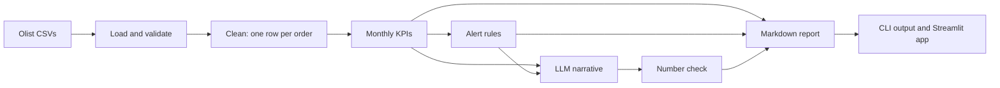

# 📊 AI Executive Report

[](https://github.com/YOUR_GITHUB_USERNAME/ai-executive-report/actions/workflows/ci.yml)
[](https://www.python.org/)
[](LICENSE)
[](#-project-status-and-roadmap)
[](https://YOUR-APP.streamlit.app)

Automated monthly executive report for a Brazilian e-commerce: Python computes the KPIs and alerts, and an LLM writes the narrative. It runs on the public Olist dataset and cuts a 5-hour reporting routine down to about 10 minutes, including human review.

**🔗 Live demo: [YOUR-APP.streamlit.app](https://YOUR-APP.streamlit.app)**

<!-- TODO: replace with a GIF of the Streamlit app (docs/screenshots/app-demo.gif) -->


## 💡 Why I built this

Monthly executive reporting is a classic time sink. Done by hand, it took me about **5 hours**: export spreadsheets, join tables, compute indicators, spot what went wrong and write it up for leadership. My first automation, a set of scripts, cut that to **1 hour**, but the analysis and the writing were still manual.

I work across product, data and processes, and this project is the next step in that same thinking: treat the report as a product, automate the repeatable parts and keep a human where judgment matters. Python does everything that must be exact (KPIs, comparisons, alert rules). The LLM does what used to take the most time: turning numbers into a clear story with recommendations. A person reviews the result in about 10 minutes.

| Process | Time per report | Saved vs. manual |
|---|---:|---:|
| Manual (spreadsheets + writing) | 5 h | – |
| Previous automation (scripts + manual writing) | 1 h | 80% |
| **This project (AI generation + human review)** | **~10 min** | **~97%** |

Every run times each stage and saves the results to `reports/metrics_YYYY-MM.json`. Method and formula: [docs/time-measurement.md](docs/time-measurement.md).

<!-- TODO: paste the output of `python scripts/benchmark.py --runs 5 --provider anthropic` here -->

## ✨ Features

- **Data cleaning**: joins 7 Olist tables into one row per order (value, freight, payment, review, category and delivery time).
- **10 monthly KPIs** compared with the previous month: revenue, orders, average ticket, unique customers, cancellation rate, delivery time, late deliveries, average review score, negative reviews and freight-to-revenue ratio.
- **Rule-based alerts with severity**: revenue drop, late deliveries concentrated in one state, category decline, low satisfaction and more. Thresholds live in `config.py`.
- **LLM-written narrative**: executive summary, alert analysis, highlights and recommendations, in Brazilian Portuguese for a Brazilian leadership team.
- **Guardrail against invented numbers**: tables are rendered by Python, and every R$ or % value the LLM quotes is checked against the computed data.
- **Multiple providers**: Claude (Anthropic), any OpenAI-compatible API (OpenAI, Groq, Gemini, Ollama) or an `offline` mode with no AI and no cost.
- **Streamlit web app**: KPI cards, charts, the full report and a time-saved panel.
- **Quality**: offline test suite with mocked LLMs, Ruff lint and formatting, and CI on GitHub Actions.

**Key design decision: the AI writes, but it doesn't calculate.** Numbers and alerts come from tested code; the LLM only receives a ready-made JSON. Details in [docs/architecture.md](docs/architecture.md).



## 🛠️ Tech stack

| Area | Tools |
|---|---|
| Language | Python 3.10+ |
| Data | pandas, numpy |
| AI | Anthropic SDK (Claude), OpenAI SDK (compatible APIs) |
| Web app | Streamlit |
| Quality | pytest, Ruff, GitHub Actions |
| Dev environment | Dev Container (GitHub Codespaces) |
| Data source | [Brazilian E-Commerce Public Dataset by Olist](https://www.kaggle.com/datasets/olistbr/brazilian-ecommerce) (Kaggle) |

## 📁 Project structure

```
ai-executive-report/
├── .devcontainer/          # Codespaces / Dev Container setup (development only)
├── .github/workflows/      # CI: lint, format check and tests on Python 3.10 and 3.12
├── .streamlit/             # app theme and secrets.toml.example
├── data/
│   ├── raw/                # real Kaggle data goes here (git-ignored)
│   └── sample/             # synthetic sample with the Olist schema, used by the demo
├── docs/
│   ├── screenshots/        # images used in this README
│   ├── architecture.md     # pipeline design and decisions
│   └── time-measurement.md # how time saved is measured
├── examples/               # sample report and metrics output
├── reports/                # generated reports (git-ignored)
├── scripts/                # Kaggle download, sample generator, benchmark
├── src/executive_report/   # main package: load → clean → KPIs → alerts → LLM → report
├── tests/                  # pytest suite (runs offline, LLM calls mocked)
├── app.py                  # Streamlit app
├── pyproject.toml          # metadata, dependencies and Ruff/pytest settings
└── requirements.txt        # dependencies for Streamlit Community Cloud
```

## 🚀 Getting started

### Prerequisites

- Python 3.10 or newer
- Git
- An API key from [Anthropic](https://console.anthropic.com) or an OpenAI-compatible provider (optional: `offline` mode works without one)
- A [Kaggle](https://www.kaggle.com) account (optional: only to download the real dataset)

### Installation

**1. Clone the repository**

```bash
git clone https://github.com/YOUR_GITHUB_USERNAME/ai-executive-report.git
cd ai-executive-report
```

**2. Create and activate a virtual environment**

```bash
python -m venv .venv
source .venv/bin/activate        # Windows: .venv\Scripts\activate
```

**3. Install the dependencies**

```bash
pip install -e ".[dev,app]"      # add ",data" to download the Kaggle dataset
```

**4. Configure your API key**

```bash
cp .env.example .env             # Windows: copy .env.example .env
```

Open `.env` and set `ANTHROPIC_API_KEY`, or set `LLM_PROVIDER=offline` to try it without a key.

**5. (Optional) Download the real data**

Without this step, the project uses the synthetic sample in `data/sample/`.

```bash
pip install -e ".[data]"
python scripts/download_data.py  # needs Kaggle credentials (Settings > API > Create New Token)
```

Or download the `.zip` from [Kaggle](https://www.kaggle.com/datasets/olistbr/brazilian-ecommerce) and extract the CSVs into `data/raw/`.

**6. Run it**

```bash
executive-report                 # command line
streamlit run app.py             # web app at http://localhost:8501
```

> **Codespaces:** click **Code → Codespaces → Create codespace** and everything is installed automatically. The `.devcontainer/` settings are for development only and don't affect the Streamlit Cloud deploy.

## 📖 Usage

**Command line**

```bash
executive-report                           # latest complete month
executive-report --month 2018-06           # specific month
executive-report --provider offline        # no AI, no cost
executive-report --provider openai --model llama-3.3-70b-versatile   # e.g. Groq
```

```text
$ executive-report --provider offline
Report saved to reports/report_2018-08.md
Alerts: 4 · Total time: 0.3 s
  1_load_data             0.14 s
  2_clean                 0.15 s
  3_kpis_and_alerts       0.05 s
  4_llm_narrative         0.00 s
  5_render_report         0.00 s
```

See the full output in [examples/report_2018-08_sample_offline.md](examples/report_2018-08_sample_offline.md).

**As a library**

```python
from executive_report.config import LLMSettings
from executive_report.pipeline import run_pipeline

result = run_pipeline(month="2018-08", settings=LLMSettings(provider="anthropic"))
print(result.markdown)  # full report (Brazilian Portuguese)
print(result.alerts)  # alerts with severity
print(result.timings)  # seconds per stage
```

**Configuration**

| Variable | Default | Description |
|---|---|---|
| `LLM_PROVIDER` | `anthropic` | `anthropic`, `openai` or `offline` |
| `LLM_MODEL` | provider default | e.g. `claude-sonnet-5-5`, `gpt-4o-mini` |
| `ANTHROPIC_API_KEY` | – | Anthropic key |
| `OPENAI_API_KEY` / `OPENAI_BASE_URL` | – | key and URL for any OpenAI-compatible API |
| `LLM_TEMPERATURE` | `0.2` | low, for consistent answers |

Alert thresholds are in `AlertThresholds` (`src/executive_report/config.py`).

**Deploying to Streamlit Community Cloud**

1. Sign in at [share.streamlit.io](https://share.streamlit.io) with GitHub.
2. **Create app** → this repository, branch `main`, main file `app.py`.
3. Under **Advanced settings → Secrets**, paste the contents of `.streamlit/secrets.toml.example` with your key. Without a key, the demo runs in offline mode.
4. Click **Deploy**. The app uses the synthetic sample, so no Kaggle data is needed.

## 🧪 Running the tests

```bash
pytest                 # test suite, fully offline (LLM calls are mocked)
ruff check .           # lint
ruff format --check .  # formatting (run `ruff format .` to fix)
```

The same checks run on every push and pull request on Python 3.10 and 3.12.

## 📌 Project status and roadmap

**Status:** ✅ complete (v1.0)

- [x] Data pipeline with 10 KPIs and month-over-month comparison
- [x] Rule-based alerts with severity
- [x] LLM narrative with Claude and OpenAI-compatible providers
- [x] Guardrail against numbers not found in the data
- [x] Streamlit app and CI
- [ ] Export the report as PDF and email it on a schedule
- [ ] Next-month revenue forecast
- [ ] Sentiment analysis of review comments
- [ ] Order-level drill-down for each alert

## ⚠️ Limitations and privacy

- **Fictitious demo data:** the live demo and `data/sample/` use **synthetic data** generated by `scripts/generate_sample_data.py`. It follows the Olist schema, but its numbers are not real. For a real analysis, download the original dataset.
- **No private data:** the project only uses public or synthetic data. Nothing comes from real companies or customers.
- **Cost:** each report is one LLM call of a few thousand tokens, usually a few cents. The app caches reports for 24 hours per month and provider, so repeat visitors don't trigger new calls. `offline` mode costs nothing.
- **API keys:** keys are read from `.env` or Streamlit Secrets and never stored in the code. A key typed into the app is used only in that session and is never saved.
- **AI limits:** LLMs can still misread context or overstate causes. Numbers are protected by the guardrail, but the interpretation should always get a human review before it is shared.
- **Language:** the generated report is in Brazilian Portuguese, by design.
- **Dataset license:** the Olist dataset is licensed CC BY-NC-SA 4.0 and is not included in this repository.

## 🤝 Contributing

Contributions are welcome! Read [CONTRIBUTING.md](CONTRIBUTING.md) to learn how to open issues and pull requests.

## 📄 License

Released under the [MIT License](LICENSE).

## 👤 Author

**Rafaela Uto** · [LinkedIn](https://www.linkedin.com/in/YOUR_LINKEDIN) · [GitHub](https://github.com/YOUR_GITHUB_USERNAME)
