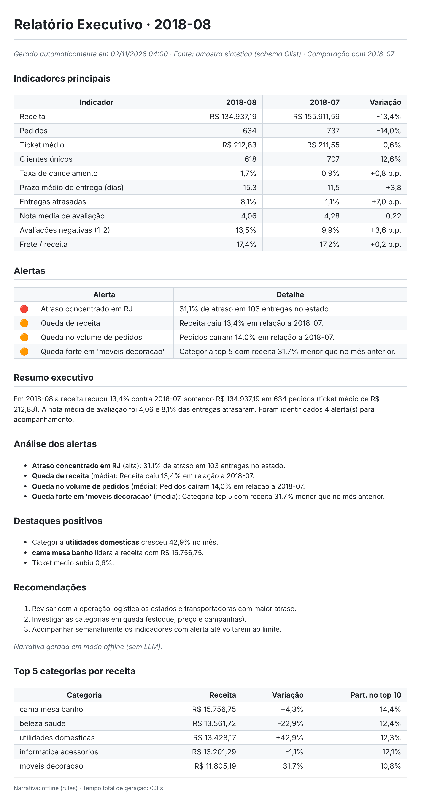
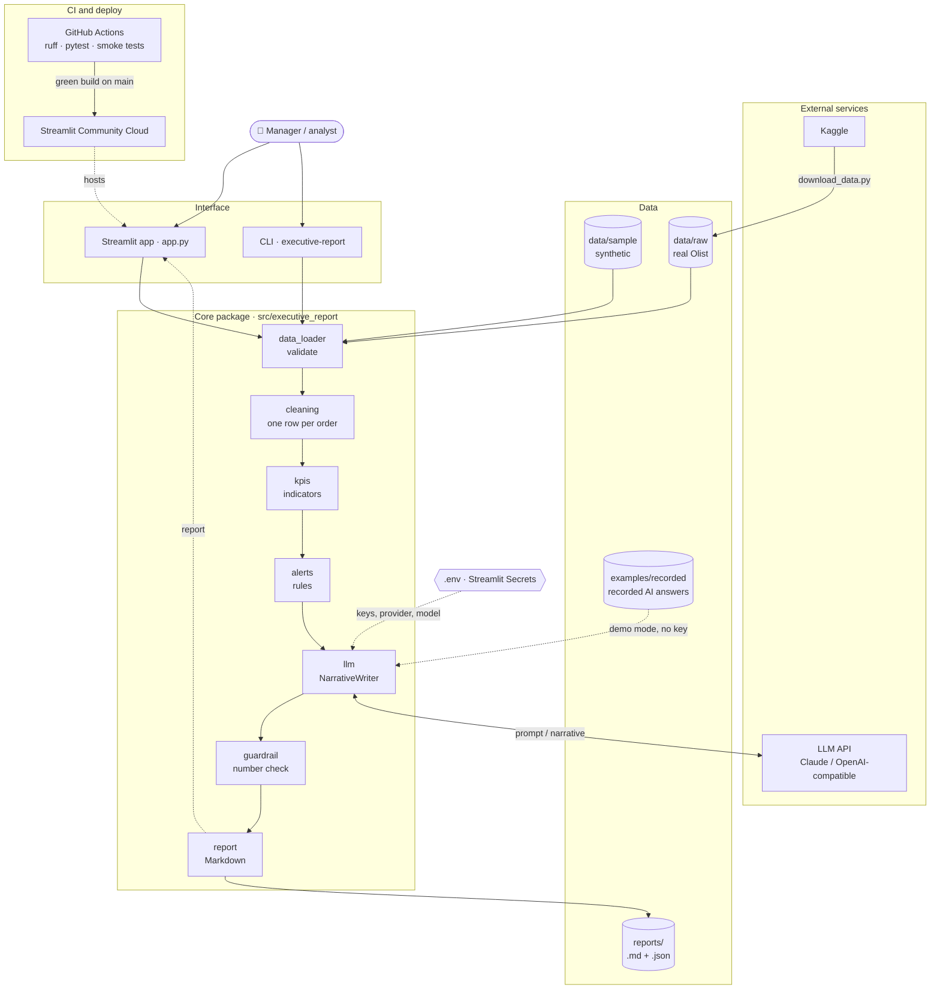

# 📊 AI Executive Report

[](https://github.com/rafauto/ai-executive-report/actions/workflows/ci.yml)
[](https://www.python.org/)
[](LICENSE)
[](#-project-status-and-roadmap)
[](https://ai-executive-report.streamlit.app)

Automated monthly executive report for a Brazilian e-commerce: Python computes the KPIs and alerts, and an LLM writes the narrative. It runs on the public Olist dataset and cuts a 5-hour reporting routine down to about 10 minutes, including human review.

**🔗 Live demo: [ai-executive-report.streamlit.app](https://ai-executive-report.streamlit.app)** · no sign-up and no API key needed (demo mode with sample data and recorded AI answers)

<!-- TODO: replace with a GIF of the Streamlit app (docs/screenshots/app-demo.gif) -->


## 💡 Why I built this

**The problem:** e-commerce managers lose about five hours every month turning raw order data into an executive report, because indicators, alerts and the written analysis are all assembled by hand.

I've lived that routine. Done by hand, it took me about **5 hours**: export spreadsheets, join tables, compute indicators, spot what went wrong and write it up for leadership. My first automation, a set of scripts, cut that to **1 hour**, but the analysis and the writing were still manual.

I work across product, data and processes, and this project is the next step in that same thinking: treat the report as a product, automate the repeatable parts and keep a human where judgment matters. Python does everything that must be exact. The LLM does what used to take the most time: turning numbers into a clear story with recommendations. A person reviews the result in about 10 minutes.

**Success criterion:** automated generation in under 2 minutes, 15 minutes or less per report including review, and zero numbers in the AI text that aren't in the data. Persona, MVP hypothesis and validation plan: [docs/product-brief.md](docs/product-brief.md).

| Process | Time per report | Saved vs. manual |
|---|---:|---:|
| Manual (spreadsheets + writing) | 5 h | – |
| Previous automation (scripts + manual writing) | 1 h | 80% |
| **This project (AI generation + human review)** | **~10 min** | **~97%** |

## ✨ Features

- **Data cleaning**: joins 7 Olist tables into one row per order (value, freight, payment, review, category and delivery time).
- **10 monthly KPIs** compared with the previous month: revenue, orders, average ticket, unique customers, cancellation rate, delivery time, late deliveries, average review score, negative reviews and freight-to-revenue ratio.
- **Rule-based alerts with severity**: revenue drop, late deliveries concentrated in one state, category decline, low satisfaction and more.
- **LLM-written narrative**: executive summary, alert analysis, highlights and recommendations, in Brazilian Portuguese for a Brazilian leadership team.
- **Guardrail against invented numbers**: tables are rendered by Python, and every R$ or % value the LLM quotes is checked against the computed data.
- **Provider-agnostic**: Claude (Anthropic), any OpenAI-compatible API (OpenAI, Groq, Gemini, Ollama), replayed `recorded` answers or a rule-based `offline` mode.
- **Demo mode without a key**: the public app replays real AI answers recorded for the sample data, so visitors see genuine output at no cost.
- **Resilient**: timeouts and retries on LLM calls; if the provider fails, the app falls back to the offline narrative instead of breaking.
- **AI evaluation**: a fixed set of cases scores every narrative on five checks against a minimum target of 80%, so prompt or provider changes can be compared.
- **Streamlit web app**: KPI cards, charts, the full report and a time-saved panel.

## 📈 Example output

August 2018 on the synthetic sample (fictitious numbers). Full report: [examples/report_2018-08_sample_offline.md](examples/report_2018-08_sample_offline.md) · metrics: [examples/metrics_2018-08_sample_offline.json](examples/metrics_2018-08_sample_offline.json).

| Indicator | 2018-08 | 2018-07 | Change |
|---|---:|---:|---:|
| Revenue | R$ 134,937.19 | R$ 155,911.59 | -13.4% |
| Orders | 634 | 737 | -14.0% |
| Average ticket | R$ 212.83 | R$ 211.55 | +0.6% |
| Late deliveries | 8.1% | 1.1% | +7.0 p.p. |
| Average review score | 4.06 | 4.28 | -0.22 |

| Severity | Alert raised |
|---|---|
| 🔴 high | Late deliveries concentrated in RJ: 31.1% of 103 deliveries |
| 🟠 medium | Revenue down 13.4% vs. July |
| 🟠 medium | Orders down 14.0% vs. July |
| 🟠 medium | "moveis decoracao" category revenue down 31.7% |

Evaluation of the offline writer on the 5 fixed cases: **100% pass rate** (`python scripts/run_eval.py --provider offline`).

<!-- TODO: add the eval pass rate and benchmark for Claude on the real data:
python scripts/run_eval.py --provider anthropic --data-dir data/raw
python scripts/benchmark.py --runs 5 --provider anthropic -->

## 🛠️ Tech stack

| Area | Tools |
|---|---|
| Language | Python 3.10+ |
| Data | pandas, numpy |
| AI | Anthropic SDK (Claude), OpenAI SDK (compatible APIs) |
| Web app | Streamlit |
| Quality | pytest, Ruff, GitHub Actions, Dependabot |
| Dev environment | venv, Dev Container (GitHub Codespaces) |
| Deploy | Streamlit Community Cloud |
| Data source | [Brazilian E-Commerce Public Dataset by Olist](https://www.kaggle.com/datasets/olistbr/brazilian-ecommerce) (Kaggle) |

## 🏗️ Architecture



The user picks a month in the app or the CLI, and the core package loads the CSVs, computes KPIs and applies the alert rules. Only then does the LLM receive the numbers as JSON and write the narrative (in the key-less demo, a recorded answer is replayed instead); the guardrail checks every number it quotes before the report is rendered and saved. Keys come from `.env` or Streamlit Secrets, and GitHub Actions validates every change that Streamlit Cloud deploys.

**Layers:** interface (`app.py`, `cli.py`) · business rules (`kpis`, `alerts`, `guardrail`) · data access (`data_loader`, `cleaning`) · external integrations (`llm`, behind the `NarrativeWriter` interface). Diagram source: [docs/architecture.mmd](docs/architecture.mmd).

**Key design decisions** (details in [docs/decisions/](docs/decisions/)):

1. [The LLM writes, code calculates](docs/decisions/0001-llm-writes-code-calculates.md): numbers never depend on the model.
2. [Synthetic sample for the demo](docs/decisions/0002-synthetic-sample-for-demo.md): one-click demo and CI with no licensed data.
3. [Provider-agnostic writers](docs/decisions/0003-provider-agnostic-writers.md): switch LLMs by configuration and test with fakes.

More on the pipeline: [docs/architecture.md](docs/architecture.md).

## 📁 Project structure

```
ai-executive-report/
├── .devcontainer/          # Codespaces / Dev Container setup (development only)
├── .github/                # CI workflow, Dependabot, issue and pull request templates
├── .streamlit/             # app theme and secrets.toml.example
├── data/
│   ├── raw/                # real Kaggle data goes here (git-ignored)
│   └── sample/             # synthetic sample with the Olist schema, used by the demo
├── docs/
│   ├── decisions/          # architecture decision records (ADRs)
│   ├── screenshots/        # images used in this README
│   ├── architecture.*      # diagram source (.mmd) and image (.png), design notes (.md)
│   ├── product-brief.md    # problem, persona, success criteria, MVP hypothesis
│   └── time-measurement.md # how time saved is measured
├── examples/               # sample report, metrics and recorded AI answers (recorded/)
├── reports/                # generated reports (git-ignored)
├── scripts/                # Kaggle download, sample generator, benchmark, eval, recording
├── src/executive_report/   # main package: load → clean → KPIs → alerts → LLM → report
├── tests/                  # pytest suite (offline, LLM calls mocked) and fixtures/
├── app.py                  # Streamlit app
├── CHANGELOG.md            # changes per version
├── pyproject.toml          # metadata, dependencies and Ruff/pytest settings
└── requirements.txt        # dependencies for Streamlit Community Cloud
```

## 🚀 Getting started

### Prerequisites

- Python 3.10 or newer
- Git
- An API key from [Anthropic](https://console.anthropic.com) or an OpenAI-compatible provider (optional: `offline` mode works without one)
- A [Kaggle](https://www.kaggle.com) account (optional: only to download the real dataset)

### Installation

**1. Clone the repository**

```bash
git clone https://github.com/rafauto/ai-executive-report.git
cd ai-executive-report
```

**2. Create and activate a virtual environment**

```bash
python -m venv .venv
source .venv/bin/activate        # Windows: .venv\Scripts\activate
```

**3. Install the dependencies**

```bash
pip install -e ".[dev,app]"      # add ",data" to download the Kaggle dataset
```

**4. Configure your API key**

```bash
cp .env.example .env             # Windows: copy .env.example .env
```

Open `.env` and set `ANTHROPIC_API_KEY`, or set `LLM_PROVIDER=offline` to try it without a key.

**5. (Optional) Download the real data**

Without this step, the project uses the synthetic sample in `data/sample/`.

```bash
pip install -e ".[data]"
python scripts/download_data.py  # needs Kaggle credentials (Settings > API > Create New Token)
```

Or download the `.zip` from [Kaggle](https://www.kaggle.com/datasets/olistbr/brazilian-ecommerce) and extract the CSVs into `data/raw/`.

**6. Run it**

```bash
executive-report                 # command line
streamlit run app.py             # web app at http://localhost:8501
```

> **Development-only settings:** `.devcontainer/` (Codespaces: **Code → Codespaces → Create codespace** installs everything) and the `--verbose` CLI flag are for development. They don't affect the Streamlit Cloud deploy.

## 📖 Usage

**Command line**

```bash
executive-report                           # latest complete month
executive-report --month 2018-06           # specific month (validated against the data)
executive-report --provider recorded       # demo mode: replays recorded AI answers (sample data)
executive-report --provider offline        # rule-based text: no AI, no key, no cost
executive-report --provider openai --model llama-3.3-70b-versatile   # e.g. Groq
executive-report --verbose                 # detailed logs
```

```text
$ executive-report --provider offline
Report saved to reports/report_2018-08.md
Alerts: 4 · Total time: 0.3 s
  1_load_data             0.14 s
  2_clean                 0.15 s
  3_kpis_and_alerts       0.05 s
  4_llm_narrative         0.00 s
  5_render_report         0.00 s
```

**As a library**

```python
from executive_report.config import LLMSettings
from executive_report.pipeline import run_pipeline

result = run_pipeline(month="2018-08", settings=LLMSettings(provider="anthropic"))
print(result.markdown)  # full report (Brazilian Portuguese)
print(result.alerts)  # alerts with severity
print(result.total_seconds)  # generation time
```

**Configuration**

| Variable | Default | Description |
|---|---|---|
| `LLM_PROVIDER` | `anthropic` | `anthropic`, `openai`, `recorded` or `offline` |
| `LLM_MODEL` | provider default | e.g. `claude-sonnet-5-5`, `gpt-4o-mini` |
| `ANTHROPIC_API_KEY` | – | Anthropic key |
| `OPENAI_API_KEY` / `OPENAI_BASE_URL` | – | key and URL for any OpenAI-compatible API |
| `LLM_TEMPERATURE` / `LLM_MAX_TOKENS` | `0.2` / `2000` | consistency and cost cap per call |
| `LLM_TIMEOUT` / `LLM_MAX_RETRIES` | `60` / `2` | seconds per call and retries with backoff |
| `MAX_LLM_REPORTS_PER_SESSION` | `5` | AI reports per visitor session in the app |

Alert thresholds are in `AlertThresholds` (`src/executive_report/config.py`).

## 🧪 Running the tests

```bash
pytest                 # unit, integration, regression and app smoke tests, fully offline
ruff check .           # lint
ruff format --check .  # formatting (run `ruff format .` to fix)
python scripts/run_eval.py --provider offline   # AI evaluation harness (target: 80% or more)
```

Tests never call a real API: LLM SDKs are mocked and the pipeline accepts a fake writer. CI runs all of the above on Python 3.10 and 3.12 for every push and pull request, plus an end-to-end CLI run in demo mode.

## ☁️ Deployment

The live demo runs on **Streamlit Community Cloud** from the `main` branch: [ai-executive-report.streamlit.app](https://ai-executive-report.streamlit.app).

To publish your own copy:

1. Fork this repository and sign in at [share.streamlit.io](https://share.streamlit.io) with GitHub. Optionally record real AI answers for the demo first: `python scripts/record_responses.py --provider anthropic`, then commit `examples/recorded/`.
2. **Create app** → your fork, branch `main`, main file `app.py`, and pick the app URL (this demo uses `ai-executive-report`).
3. Under **Advanced settings → Secrets**, paste `.streamlit/secrets.toml.example` with your key. Without a key, the app runs in demo mode: recorded answers when `examples/recorded/` has them, rule-based text otherwise.
4. Click **Deploy**. Streamlit Cloud redeploys on every push to `main`, so protect `main` and merge only pull requests with a green CI.

**Rollback:** every version is a Git tag (`v0.1.0`, `v1.0.0`). To go back, revert the faulty commit on `main` (`git revert <sha>`) or check out the last good tag. The demo data is regenerated with `python scripts/generate_sample_data.py`.

## 📌 Project status and roadmap

**Status:** ✅ v1.0 complete. Changes per version in [CHANGELOG.md](CHANGELOG.md).

- [x] MVP (v0.1.0): pipeline, 10 KPIs, alerts, LLM narrative, guardrail, CLI
- [x] v1.0.0: Streamlit app, provider-agnostic writers, fallback, evaluation, CI smoke tests
- [ ] Validate the report with a real reader and log the feedback
- [ ] Export the report as PDF and email it on a schedule
- [ ] Next-month revenue forecast
- [ ] Order-level drill-down for each alert
- [ ] Sentiment analysis of review comments

## ⚠️ Limitations and privacy

- **Fictitious demo data:** the live demo and `data/sample/` use **synthetic data**. It follows the Olist schema, but its numbers are not real. For a real analysis, download the original dataset.
- **No private data:** the project only uses public or synthetic data. Nothing comes from real companies or people, and no personal data is sent to the LLM (only aggregated numbers and category names).
- **Recorded answers:** the demo replays answers recorded on the synthetic sample, one per month in `examples/recorded/`. Other months fall back to the rule-based text.
- **Cost:** each report is one LLM call of a few thousand tokens, capped by `LLM_MAX_TOKENS`. The app caches reports for 24 hours and limits each session to `MAX_LLM_REPORTS_PER_SESSION` AI reports. `offline` mode costs nothing.
- **API keys:** read from `.env` or Streamlit Secrets, never stored in code. A key typed into the app is used only in that session and never saved.
- **Prompt injection:** labels from the data are sanitized and the prompt tells the model to treat the JSON as data only. This lowers the risk but doesn't remove it.
- **AI limits:** the guardrail protects numbers, not reasoning. The LLM can still misread causes, so a person should review every report before it's shared.
- **Language:** the generated report is in Brazilian Portuguese, by design.
- **Dataset license:** the Olist dataset is licensed CC BY-NC-SA 4.0 and is not included in this repository.

## 🤝 Contributing

Contributions are welcome! Read [CONTRIBUTING.md](CONTRIBUTING.md) to learn how to open issues and pull requests.

## 📄 License

Released under the [MIT License](LICENSE).

## 👤 Author

**Rafaela Uto** · [LinkedIn](https://www.linkedin.com/in/rafaelauto/) · [GitHub](https://github.com/rafauto)
